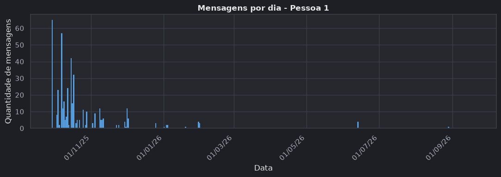
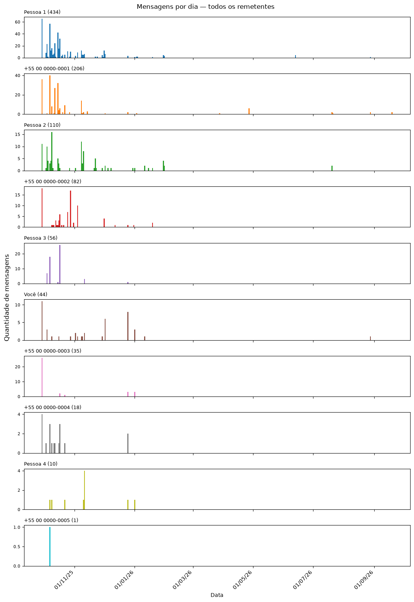
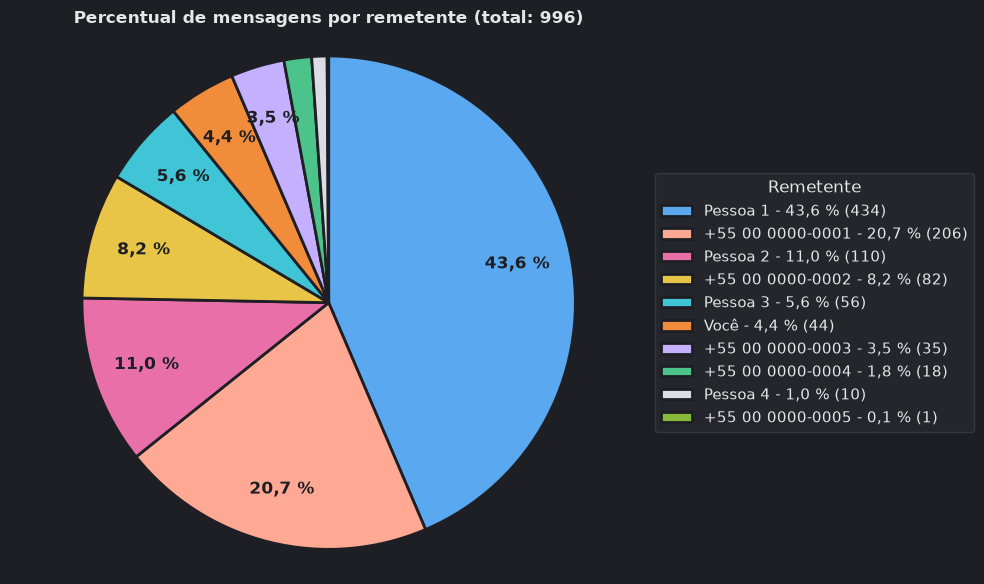
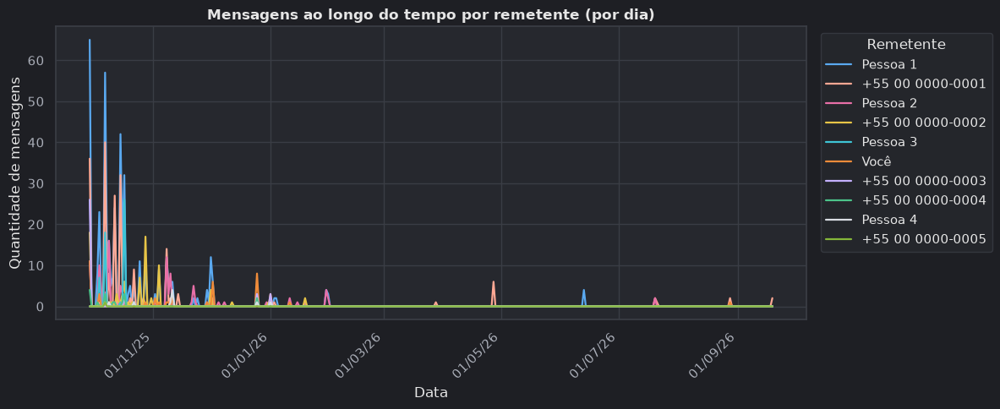
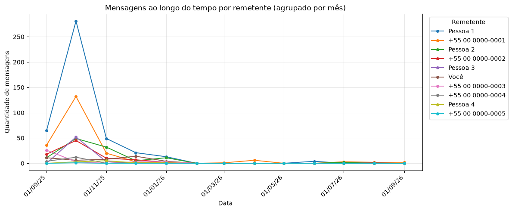

# Análise de Dados de Conversas do WhatsApp

Trabalho de Data Science (A2). Notebook Jupyter que lê a exportação `.txt` de um grupo do WhatsApp, monta um `pandas.DataFrame` com **data**, **hora**, **remetente** e **mensagem** e oferece cinco análises: um resumo por remetente, o histórico de um remetente e três gráficos (histórico por dia, pizza e linhas).

**Integrantes:**
- Integrante 1
- Integrante 2

## Requisitos

- **Python 3.14** (3.12 e 3.13 também funcionam; o mínimo é 3.12 por causa do NumPy 2.5).
- Dependências fixadas em [`requirements.txt`](requirements.txt): pandas 3.0.6, matplotlib 3.11.2, seaborn 0.13.2, ipywidgets 8.1.9, jupyterlab 4.6.4 e ipykernel 7.4.0. O pytest 9.1.1 fica em [`requirements-dev.txt`](requirements-dev.txt).

## Instalação

### Com `venv` (Windows)

```bash
py -3.14 -m venv .venv
```

```bash
.venv\Scripts\activate
```

```bash
pip install -r requirements-dev.txt
```

No Linux/macOS, use `python3.14 -m venv .venv` e `source .venv/bin/activate`.

### Com conda

```bash
conda create -n whatsapp-analise python=3.14
```

```bash
conda activate whatsapp-analise
```

```bash
pip install -r requirements-dev.txt
```

## Como rodar

```bash
jupyter lab
```

Abra [`analise_whatsapp.ipynb`](analise_whatsapp.ipynb) e use **Run → Run All Cells**. O notebook lê `dados/chat.txt`, a conversa exportada do grupo. Esse arquivo não está no repositório: coloque a sua exportação nesse caminho ou troque a variável `CAMINHO`. Para analisar outra conversa:

- clique em **Carregar .txt** (seção 1) e escolha o arquivo: todas as seções são atualizadas; ou
- troque a variável `CAMINHO` e rode tudo de novo.

O remetente do histórico (seção 5) e do gráfico do histórico (seção 6) e o agrupamento do gráfico de linhas (seção 8) são escolhidos em listas, sem alterar código.

O notebook está salvo **com as saídas**, então dá para ver os resultados no GitHub sem executar nada (com a opção padrão de cada lista). As listas e o painel interativo (ipywidgets) só funcionam com um kernel rodando.

Os gráficos usam o seaborn com um tema escuro próprio (fundo grafite e 10 cores claras, uma por remetente). O gráfico de pizza é feito com o matplotlib, porque o seaborn não tem pizza, mas usa o mesmo tema e as mesmas cores. As tabelas seguem o tema do JupyterLab: para deixar tudo escuro, use **Settings → Theme → JupyterLab Dark**.

Para rodar os testes:

```bash
pytest
```

## Como exportar a conversa do WhatsApp

- **Android:** abra o grupo → menu **⋮** → **Mais** → **Exportar conversa** → **Sem mídia**.
- **iPhone:** abra o grupo → toque no nome do grupo → **Exportar conversa** → **Sem mídia**. O iPhone gera um `.zip`; extraia o `_chat.txt` de dentro dele.

O leitor aceita os dois formatos (iPhone `[M/D/AA, H:MM:SS PM] Nome: texto` e Android `DD/MM/AAAA HH:MM - Nome: texto`) e descobre sozinho se a data está em dia/mês ou mês/dia.

> **Privacidade:** a conversa real tem números de telefone e conteúdo pessoal. O `.gitignore` ignora `dados/*.txt`, mas as saídas salvas no notebook mostram as mensagens da conversa analisada.

## O que o notebook faz

| Requisito | Onde |
|-----------|------|
| R1/R2 — ler o `.txt` e montar o DataFrame | `whatsapp_analise/parser.py` (`ler_conversa`) |
| R3 — tabela completa | Seção 2 do notebook |
| R4 — resumo das conversas | `resumo_conversas` (seção 4 e painel) |
| R5 — histórico do remetente | `historico_remetente` (seção 5 e painel) |
| R6 — gráfico do histórico | `grafico_historico_remetente` (seção 6 e painel) |
| R7 — gráfico de pizza | `grafico_pizza` (seção 7 e painel) |
| R8 — gráfico de linhas | `grafico_linhas` (seção 8 e painel) |

Regras de leitura:

- Cada mensagem com data, hora e remetente conta como uma "conversa".
- Mensagens do sistema (ligações, notificações, avisos de criptografia, eventos sem remetente) ficam fora do DataFrame; o total ignorado aparece ao carregar o arquivo.
- Mídias omitidas (`<imagem ocultada>`, `<figurinha omitida>`…) e `Mensagem apagada` contam como mensagens.
- Mensagens com várias linhas (incluindo enquetes) viram um registro só, com as linhas separadas por `\n`.

## Estrutura

```text
whatsapp-analise/
├── analise_whatsapp.ipynb       # notebook principal (entregável)
├── whatsapp_analise/
│   ├── parser.py                # .txt -> DataFrame
│   ├── analises.py              # tabelas (R4, R5) e contagens por período
│   ├── graficos.py              # gráficos seaborn e tema escuro (R6, R7, R8)
│   └── interface.py             # painel ipywidgets
├── dados/                       # coloque aqui o chat.txt (não versionado)
├── docs/img/                    # prints dos gráficos usados neste README
└── tests/
    ├── test_parser.py           # leitura e análises
    └── test_graficos.py         # gráficos
```

## Gráficos (conversa de exemplo)

Os prints abaixo usam uma versão anonimizada da conversa: os horários e a quantidade de mensagens de cada pessoa foram mantidos, mas os nomes e os números foram trocados.

**R6 — mensagens por dia de um remetente**



**R6 — mensagens por dia, todos os remetentes**



**R7 — percentual de mensagens por remetente**



**R8 — mensagens ao longo do tempo (por dia e por mês)**




